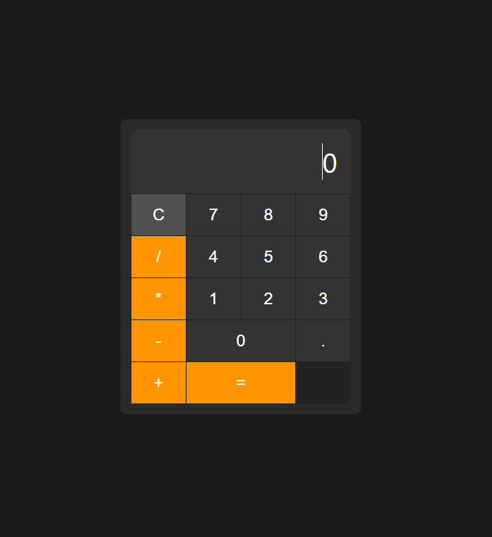

# Java Web Calculator (Spring Boot, No JavaScript)

A simple calculator web app built with Spring Boot. All logic runs on the server—no JavaScript required.

## Features

- Add, subtract, multiply, divide
- Form submits to controller via POST
- Result displayed on the same page (Thymeleaf templates)
- Handles division by zero and invalid input
- Basic responsive layout with inline CSS

## Requirements

- Java 17+
- Maven 3.6+

## Build

```bash
mvn clean package
```

## Run

```bash
mvn spring-boot:run
```

Or run the JAR:

```bash
java -jar target/web-calculator-1.0-SNAPSHOT.jar
```

Then open: http://localhost:8080/calculator

## Project Structure

```
src/main/java/com/calculator/
  CalculatorApplication.java  - Spring Boot entry point
  CalculatorController.java   - Handles GET (form) and POST (calculation)
src/main/resources/templates/
  calculator.html            - Thymeleaf template
```
